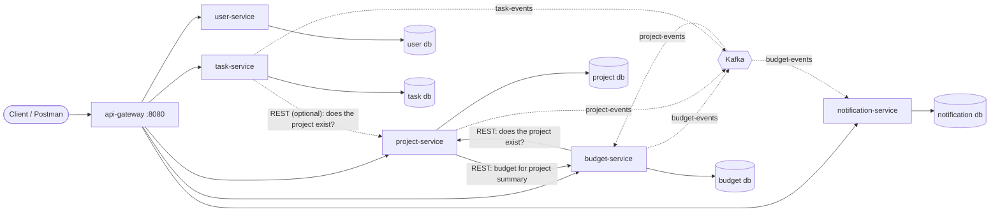
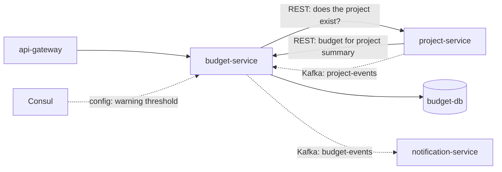
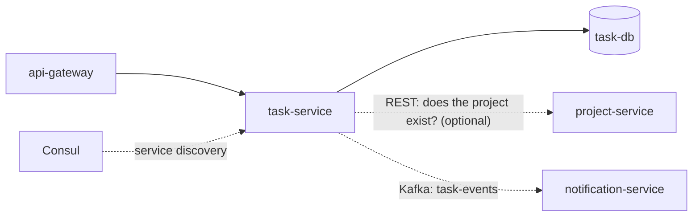

# Re-Build

Re-Build is a microservice application for homeowners who are renovating their home.
The project owner can create renovation projects, keep track of the budget and expenses,
plan tasks, and get notifications when something important happens, for example when the budget is close to being used up.

PG3402 Microservices – exam project.

Each service has its own README with more details.

## Build and run

Requirements: Docker Desktop (with Docker Compose).

From the root folder of the project:

```bash
docker compose up --build
```

The first build takes a few minutes. Wait 1–2 minutes after the containers have started, so all services have registered in Consul.

- All requests go through the gateway: `http://localhost:8080`
- Consul UI (health checks and configuration): `http://localhost:8500`
- Start again with empty databases and fresh test data: `docker compose down -v` and then `docker compose up --build`
- Several instances of a service: `docker compose up --build --scale budget-service=2`

Ports inside Docker: api-gateway 8080, user-service 8081, task-service 8082, notification-service 8083, budget-service 8084, project-service 8085.

## Architecture

Solid arrows are synchronous communication (REST), dotted arrows are asynchronous communication (Kafka).



All services register in **Consul**, which is used for service discovery, load balancing, health checks (`/actuator/health`) and central configuration.
Each service has its own database, so no service reads another service's data directly.

## Services

### api-gateway


### user-service


### notification-service


### project-service


### budget-service

Keeps track of the budget and expenses for each renovation project. Calculates how much is spent, how much is left and the status (`OK`, `WARNING`, `EXCEEDED`), and warns other services when a project is close to or over its budget.



Main user stories:

1. Create a budget for a project: `POST /api/budgets` `{ "projectId": 3, "totalAmount": 60000 }` → `201 Created`
2. Get a warning when the budget is almost used: `POST /api/budgets/2/expenses` `{ "description": "Paint", "amount": 2000, "category": "MATERIALS" }` → status `WARNING` and a `budget.warning` event
3. Cannot create a budget for a project that does not exist: `POST /api/budgets` `{ "projectId": 999, "totalAmount": 1000 }` → `404 Not Found`
4. The budget is deleted when the project is deleted (`PROJECT_DELETED` from project-service)
5. Change the default warning threshold centrally in Consul, without restarting the service:
   in Consul (`http://localhost:8500`) → Key/Value → Create key `config/budget-service/data`
   with value `budget.defaults.warning-threshold=70` → new budgets get `"warningThresholdPercent": 70` (default is 80)

Full details, all endpoints, test data and Postman collection: [budget-service/README.md](budget-service/README.md)

### task-service

Keeps track of the tasks in a renovation project. A task belongs to a project and can be assigned to a contractor. Only the assigned contractor can change the status, and the homeowner can follow the progress of a project. When the status changes, an event is published to Kafka.



Main user stories:

1. Divide a project into tasks: `POST /api/tasks` `{ "projectId": 5, "title": "Living room", "deadline": "2026-12-01" }` → `201 Created` with status `PLANNED`
2. Assign a contractor to a task: `PATCH /api/tasks/1/contractor?contractorId=3`
3. The contractor updates the status of an assigned task: `PATCH /api/tasks/1/status?status=COMPLETED&contractorId=3` → `200 OK` and a `TaskCompleted` event on `task-events`
4. Only the assigned contractor can change the status: the same request with `contractorId=7` → `403 Forbidden`
5. The homeowner follows the progress of a project: `GET /api/tasks/project/5/progress` → number of tasks per status and the percentage completed

Full details, all endpoints and configuration: [task-service/README.md](task-service/README.md)

## Decisions, assumptions and simplifications

- One database per service. Services only share data through REST and Kafka.
- Kafka for events, as in the lectures. Events are plain JSON, so services do not share code, but they must agree on field names such as `projectId`.
- Budget-service is the only owner of the budget amount. Project-service asks budget-service when it needs the budget, so the numbers are kept in only one place.
- No frontend. All functionality is tested through the gateway with Postman or Swagger.
- Consul runs in development mode. Values in Consul Key/Value are lost when Consul restarts.
- No login. `ownerId` and `contractorId` are sent in the request.
- Only the assigned contractor can change the status of a task. Without a login, the contractor's id is sent as a request parameter, and it is not checked against user-service.
- Task-service can check that a project exists in project-service (`PROJECT_VALIDATION_ENABLED`). It is off by default, so task-service can be started and tested alone.
- Task events are published to Kafka after the task is saved, but not in the same transaction. If Kafka is down, the event is lost (a transactional outbox would fix this).

## Changes from the arbeidskrav
- Task-service gets a progress endpoint (`GET /api/tasks/project/{id}/progress`), so the homeowner can follow the renovation. This was not in the arbeidskrav.
- Only the assigned contractor can change the status of a task.