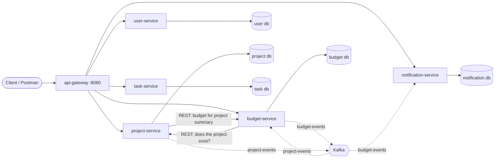
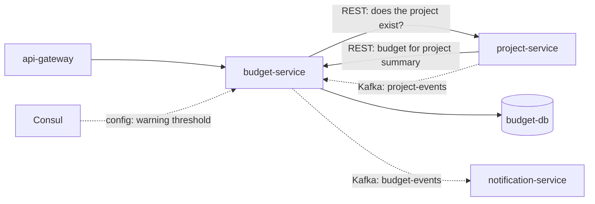

# Re-Build

Re-Build is a platform for homeowners who are renovating their home, and the contractors who do the work.

The homeowner can create a renovation project, divide it into tasks with deadlines, assign contractors, and follow both the progress and the budget. Contractors update the status of the tasks assigned to them. When something important happens – for example when the budget is close to being used up – the system sends a notification.

The system is built as microservices: user, project, task, budget and notification services, an API gateway as the single entry point, Consul for service discovery, health checks and configuration, and Kafka for events between the services. Everything runs with one `docker compose up`.

## Build and run

Requirements: Docker Desktop (with Docker Compose).

From the root folder of the project:

```bash
docker compose up --build
```

The first build takes a few minutes. Wait 1–2 minutes after the containers have started, so all services have registered in Consul.

- All requests go through the gateway: `http://localhost:8080`
- Consul UI (health checks and configuration): `http://localhost:8500`
- Start again with empty databases and fresh test data: `docker compose down -v` and then `docker compose up --build`
- Several instances of a service: `docker compose up --build --scale budget-service=2`

Ports inside Docker: api-gateway 8080, user-service 8081, task-service 8082, notification-service 8083, budget-service 8084, project-service 8085.

## Architecture

Solid arrows are synchronous communication (REST), dotted arrows are asynchronous communication (Kafka).



All services register in **Consul**, which is used for service discovery, load balancing, health checks (`/actuator/health`) and central configuration.
Each service has its own database, so no service reads another service's data directly.

## Services

### api-gateway
API Gateways acts as a single entry points to the application and routes incoming requests to the appropriate microservices.

- Routes request to User, Project, Task, Budget and Notification Services.
- Uses Consul for service discovery instead of fixed service addresses.
- Uses Spring Cloud LoadBalancer to distribute requests between multiple service instances.
- Provides health monitoring through Spring boot Actuator

**Endpoints:** /api/users/, /api/projects, /api/tasks, /api/budgets, /api/notifications

**Port:** 8080

**Health:** http://localhost:8080/actuator/health

### user-service
User service manages users in the application, including homeowners and contractors.
- Helps creating, retrieving, updating and deleting users.
- Uses BCrypt to hash passwords
- Prevents duplicate email addresses

1. create an account : POST /api/users -> 201 Created
2. View all users: GET/ api/users -> 200 OK
3. Get user by ID : GET/ api/users/{id} -> 200 OK
4. Users by their role : GET /api/users/role{role} -> 200 OK
5. Update : PUT /api/users/{id} -> 200 OK
6. Delete : DELETE /api/users/{id} -> 204 No content

**Technologies:** Java 21, Spring Boot, PostgreSQL, Spring Data JPA, Dcoker, Maven

**Endpoints:** "/api/users", "/api/users/{id}", "/api/users/role/{role}"

**Port:** 8081
**Health:** http://localhost:8081/actuator/health

### notification-service
Notification service manages user notification and receives budget warning events through Kafka

- It creates creates, retrieves and deletes notifications
- Retrieves notifications for specific users
- Stores notifications in PostgreSQL

1. create a notification : POST /api/notifications -> 201 Created
2. View all notifications: GET/ api/notifications -> 200 OK
3. View notifications for a specific user : GET/ api/notifications/users/{userid} -> 200 OK
4. Delete : DELETE /api/notifications/{id} -> 204 No content
5. Receive budget warning events through Kafka and save them as notifications

**Technologies:** Java 21, Spring Boot, PostgreSQL, Kafka, Docker, Maven

**Endpoints:** "/api/notifications", "/api/notifications/user/{userId}"

**Port:** 8083
**Health:** 'http://localhost:8083/actuator/health'

### project-service
Project service manages renovation projects and gives the homeowner an overview of each project together with its budget.

* Creates, retrieves, updates and deletes projects, and lists the projects for a specific owner
* Validates input, for example that a project has a name and that the end date is not before the start date
* Combines a project with its budget from budget-service through REST, and still returns the project if budget-service is unavailable
* Publishes a `PROJECT_DELETED` event through Kafka when a project is deleted, so budget-service can delete the project's budget
* Creates three test projects on startup, matching the budgets in budget-service

Technologies: Java 21, Spring Boot, PostgreSQL, Spring Data JPA, Kafka, Docker, Maven
Endpoints: "/api/projects", "/api/projects/{id}", "/api/projects/{id}/summary"
Port: 8085 (only reachable through the gateway) Health: shown in Consul, http://localhost:8500


### budget-service

Keeps track of the budget and expenses for each renovation project. Calculates how much is spent, how much is left and the status (`OK`, `WARNING`, `EXCEEDED`), and warns other services when a project is close to or over its budget.



Main user stories:

1. Create a budget for a project: first create a project with `POST /api/projects` `{ "name": "Garden shed", "ownerId": 2 }` → `201 Created` (note the `id`, e.g. `4`), then `POST /api/budgets` `{ "projectId": 4, "totalAmount": 60000 }` → `201 Created`
2. Get a warning when the budget is almost used: `POST /api/budgets/2/expenses` `{ "description": "Paint", "amount": 2000, "category": "MATERIALS" }` → status `WARNING` and a `budget.warning` event
3. Cannot create a budget for a project that does not exist: `POST /api/budgets` `{ "projectId": 999, "totalAmount": 1000 }` → `404 Not Found`
4. The budget is deleted when the project is deleted (`PROJECT_DELETED` from project-service)
5. Change the default warning threshold centrally in Consul, without restarting the service:
   in Consul (`http://localhost:8500`) → Key/Value → Create key `config/budget-service/data`
   with value `budget.defaults.warning-threshold=70` → new budgets get `"warningThresholdPercent": 70` (default is 80)

Full details, all endpoints, test data and Postman collection: [budget-service/README.md](budget-service/README.md)

### task-service


## Decisions, assumptions and simplifications

- One database per service. Services only share data through REST and Kafka.
- Kafka for events, as in the lectures. Events are plain JSON, so services do not share code, but they must agree on field names such as `projectId`.
- Budget-service is the only owner of the budget amount. Project-service asks budget-service when it needs the budget, so the numbers are kept in only one place.
- No login. `ownerId` is sent in the request.
- No frontend. All functionality is tested through the gateway with Postman.
- Consul runs in development mode. Values in Consul Key/Value are lost when Consul restarts.

## Why Re-Build fits microservices

A renovation involves different parties (homeowner and contractors) and different areas (projects, tasks, budgets, users and notifications). Each area has its own data and changes at its own pace, so each one is a separate service.

### What fits especially well

- Notifications through events. Budget warnings, deleted projects and task updates are sent through Kafka. The sender does not need to know who receives the event.
- Independent scaling. Expenses and task updates happen often, projects and users rarely. Budget-service and task-service can run in more instances without scaling the rest.
- Failures stay local. If budget-service is down, project-service still shows the project.
- Clear data ownership. Each service has its own database. Only budget-service stores the budget amount.

### Changes from the arbeidskrav and When the project grows

- We went beyond the planned minimum solution and implemented most of the prototype: contractor assignment, budget tracking, notifications and the API gateway.
  
- New features, such as contractor offers, photo upload and deadline reminders, can be added as new services or new events, without changing the existing ones.
- More users means more load on budgets and tasks, and those services can be scaled behind the gateway.

For the current size, a monolith would be simpler. The microservice structure pays off as the application grow
