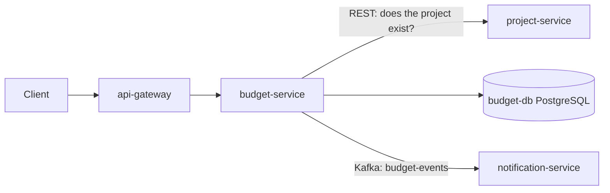

# budget-service

Kandidatnr.: 34

Budget-service keeps track of the budget for each renovation project and the expenses that are registered.
The service calculates how much money has been spent, how much is left, and what status the budget has.
It also sends alerts to other services via Kafka when a project is close to or over its budget.

## Responsibility

- Each renovation project has one budget with a total amount, a currency (default NOK) and a warning limit default (80 %).
- The project owner can register expenses on a budget, with a description, amount, category and an optional task id.
- The service calculates how much is spent, how much is left and how many percent is used.
  These values are calculated from the expenses every time, so they are always correct.
- Each budget has a status:
    - `OK` – below the warning limit
    - `WARNING` – the warning limit (80 %) or more is used
    - `EXCEEDED` – more than the total amount is spent

## Communication with other services

- Synchronous (REST): Before a budget is created, budget-service calls
  `GET /api/projects/{id}` in project-service to check that the project exists.
  The call goes through Consul and Spring Cloud LoadBalancer.
- Asynchronous (Kafka): budget-service publishes events to the Kafka topic `budget-events`:
    - `budget.created` – a new budget is created
    - `budget.warning` – the budget reaches the warning limit
    - `budget.exceeded` – the budget is exceeded

Example event:

```json
{
  "eventType": "budget.warning",
  "budgetId": 2,
  "projectId": 2,
  "percentUsed": 80.00,
  "status": "WARNING",
  "message": "Project 2 has used 80.00% of its budget"
}
```

## Architecture



budget-service registers in Consul (service discovery, health check and configuration).

## Endpoints

- `GET /api/budgets/hello` – check that the service is running
- `POST /api/budgets` – create a budget, body: `{ "projectId": 3, "totalAmount": 10000 }`
- `GET /api/budgets` – all budgets
- `GET /api/budgets/{id}` – one budget
- `GET /api/budgets/project/{projectId}` – the budget of a project
- `PUT /api/budgets/{id}` – change total amount, warning limit or currency, body e.g. `{ "totalAmount": 8000 }`
- `DELETE /api/budgets/{id}` – delete a budget
- `POST /api/budgets/{id}/expenses` – add an expense, body: `{ "description": "Tiles for bathroom", "amount": 12000, "category": "MATERIALS" }`
- `GET /api/budgets/{id}/expenses` – list expenses
- `DELETE /api/budgets/{id}/expenses/{expenseId}` – delete an expense
- `GET /actuator/health` – health check

Expense categories: `MATERIALS`, `LABOR`, `TOOLS`, `EQUIPMENT`, `PERMITS`, `OTHER`.

Errors are returned as JSON with status `400` (invalid input), `404` (not found),
`409` (project already has a budget) or `503` (project-service is not available).

## Test data

The first time the service starts (only if the database is empty), it creates:

- Project 1 (bathroom): budget 150 000 NOK, 52 500 NOK spent (35 %), status `OK`
  – tiles, plumber and building permit
- Project 2 (kitchen): budget 50 000 NOK, 38 000 NOK spent (76 %), status `OK`
  – kitchen cabinets and electrician

Project 2 is close to the warning limit, so one more expense of 2 000 NOK gives status `WARNING`.

## User stories

1. As a project owner, I want to create a budget for my renovation project, so that I know how much I can spend.
   `POST /api/budgets` with `{ "projectId": 3, "totalAmount": 10000 }` → `201 Created`, status `OK`.
   Creating a second budget for the same project → `409 Conflict`.

2. As a project owner, I want to register an expense, so that I can keep track of what the renovation costs.
   `POST /api/budgets/1/expenses` with `{ "description": "Tiles for bathroom", "amount": 12000, "category": "MATERIALS" }` → `201 Created`.

3. As a project owner, I want to see how much is spent and how much is left.
   `GET /api/budgets/project/1` → shows `spentAmount`, `remainingAmount`, `percentUsed` and `status`.

4. As a project owner, I want to be warned when the project is close to or over its budget.
   `POST /api/budgets/2/expenses` with `{ "description": "Paint", "amount": 2000, "category": "MATERIALS" }` → status `WARNING`
   and a `budget.warning` event is sent to Kafka.
   Adding `{ "description": "Carpenter", "amount": 15000, "category": "LABOR" }` → status `EXCEEDED` and a `budget.exceeded` event.

5. As a project owner, I want to change the budget when the plans change.
   `PUT /api/budgets/1` with `{ "totalAmount": 60000 }` → `200 OK`. Only the fields that are sent are changed.

6. As a project owner, I should not be able to create a budget for a project that does not exist.
   `POST /api/budgets` with `{ "projectId": 999, "totalAmount": 1000 }` → `404 Not Found`
   (requires `PROJECT_VALIDATION_ENABLED=true`).

To see the Kafka events:

```bash
docker exec -it kafka /opt/kafka/bin/kafka-console-consumer.sh --bootstrap-server localhost:9092 --topic budget-events --from-beginning
```

## Postman

All requests from the user stories are in `budget-service.postman_collection.json`.
Import it in Postman and run the requests from top to bottom. Each request has the expected response in its description.

## Build and run

From the root folder of the project:

```bash
docker compose up --build
```

- Requests go through the gateway: `http://localhost:8080/api/budgets`
- Consul: `http://localhost:8500` – budget-service should have a green health check
- Several instances: `docker compose up --build --scale budget-service=2`
- Database for testing: user `budget`, password `budget`, database `budgetdb`

## Decisions and simplifications

- Kafka is used for asynchronous communication, as in the lectures.
- Spent amount is calculated from the expenses and not stored, so it is always correct.
- One budget per project.
- Events are only sent when the status gets worse (OK → WARNING → EXCEEDED), so the project owner does not get the same alert many times.
- Events are plain JSON without Java type information, so other services can read them without sharing code.
- If Kafka is down, the budget change is still saved and the error is only logged.
- The project is only checked when the budget is created, not for every expense.
- No currency conversion: each budget has one currency (default NOK).
- `taskId` on an expense is not checked against task-service.

### Running multiple instances
docker compose up --build --scale budget-service=2 consul kafka budget-db budget-service api-gateway

Both instances register in Consul, and the gateway distributes requests between them round robin.