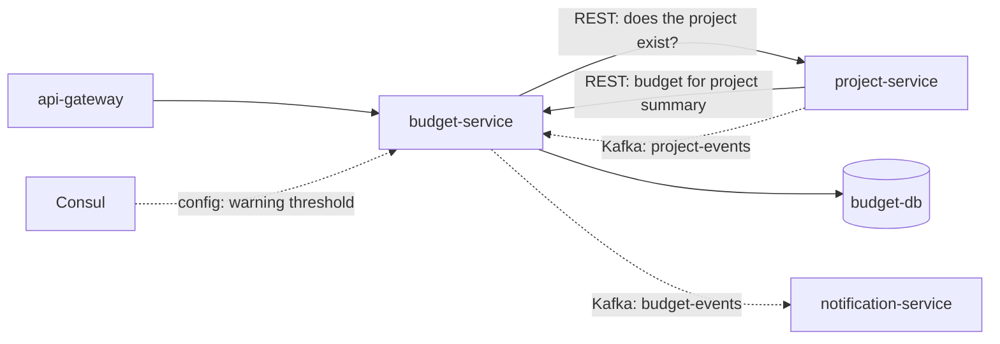

# budget-service

Kandidatnr.: 34

Keeps track of the budget and expenses for each renovation project. Calculates how much is spent, how much is left and the status: `OK`, `WARNING` (80 % or more used) or `EXCEEDED` (over budget). Warns other services through Kafka, and deletes the budget when the project is deleted.

## Architecture

Solid arrows are synchronous (REST), dotted arrows are asynchronous (Kafka).

- **Kafka out** (`budget-events`): `budget.created`, `budget.warning`, `budget.exceeded`
- **Kafka in** (`project-events`): `PROJECT_DELETED` → the budget for that project is deleted
- **Consul**: service discovery, health check (dead instances removed after 1 minute) and central configuration

## Endpoints

All through the gateway: `http://localhost:8080`

- `POST /api/budgets` – create a budget `{ "projectId": 3, "totalAmount": 60000 }`
- `GET /api/budgets`, `GET /api/budgets/{id}`, `GET /api/budgets/project/{projectId}`
- `PUT /api/budgets/{id}` – change total amount, warning limit or currency
- `DELETE /api/budgets/{id}`
- `POST /api/budgets/{id}/expenses` – `{ "description": "Paint", "amount": 2000, "category": "MATERIALS" }`
- `GET /api/budgets/{id}/expenses`, `DELETE /api/budgets/{id}/expenses/{expenseId}`

Categories: `MATERIALS`, `LABOR`, `TOOLS`, `EQUIPMENT`, `PERMITS`, `OTHER`. Errors: `400`, `404`, `409`, `503`.

## Test data

Created on startup: project 1 (bathroom) 150 000 NOK, 35 % used · project 2 (kitchen) 50 000 NOK, 76 % used · project 3 has no budget.

## User stories

1. **Create a budget:** `POST /api/budgets` `{ "projectId": 3, "totalAmount": 60000 }` → `201`. Same project again → `409`.
2. **Register an expense and see what is left:** `POST /api/budgets/1/expenses` → `201`, then `GET /api/budgets/project/1` shows `spentAmount`, `remainingAmount` and `status`.
3. **Get a warning:** `POST /api/budgets/2/expenses` `{ "description": "Paint", "amount": 2000, "category": "MATERIALS" }` → `WARNING`, and notification-service logs `Received budget event: budget.warning`.
4. **Change the budget:** `PUT /api/budgets/1` `{ "totalAmount": 60000 }` → `200`.
5. **No budget for a project that does not exist:** `POST /api/budgets` `{ "projectId": 999, "totalAmount": 1000 }` → `404`.
6. **Budget deleted with the project:** `DELETE /api/projects/3` → budget-service logs `Project 3 was deleted, so its budget was deleted too`, and `GET /api/budgets/project/3` → `404`.
7. **Central configuration:** in Consul (`http://localhost:8500`) → Key/Value → key `config/budget-service/data`, value `budget.defaults.warning-threshold=70` → new budgets get `"warningThresholdPercent": 70` without restarting (default 80).

All requests with expected responses are in `budget-service.postman_collection.json`.

## Decisions and simplifications

- Spent amount is calculated from the expenses every time, so it is always correct.
- Budget-service is the only owner of the budget amount; project-service asks for it through REST.
- Events are only sent when the status gets worse, so the owner does not get the same warning many times.
- Events are plain JSON, so services do not share code, but must agree on field names such as `projectId`.
- If Kafka is down, the budget is still saved and the error is logged. A real system would use the transactional outbox pattern.
- Consul runs in dev mode, so Key/Value values are lost on restart, and the default (80) is used.
- `taskId` on an expense is not checked against task-service. No currency conversion.